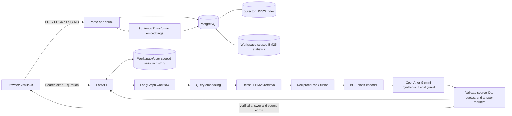
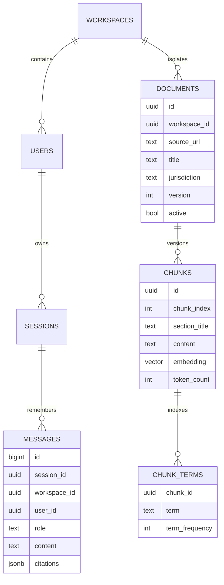

# Briefcase — Ask My Docs

**Ask questions about your legal documents and trace every answer back to its source.** Briefcase ingests PDF, DOCX, TXT, and Markdown files, searches them with dense and lexical retrieval, reranks the most relevant passages, and enforces source-grounded citations.

> **Legal information, not legal advice.** Use only sources you are authorized to process. The included evaluation documents are explicitly fictional and are not real law.

## At a glance

| | |
|---|---|
| API | Python 3.12, FastAPI, Pydantic |
| Browser app | Vanilla JavaScript and HTML/CSS served by FastAPI |
| Workflow | LangGraph |
| Database | PostgreSQL 16, pgvector, psycopg connection pool |
| Dense retrieval | Sentence Transformers, `BAAI/bge-small-en-v1.5`, 384 dimensions |
| Sparse retrieval | Indexed inverted terms with Okapi BM25 (`k1=1.2`, `b=0.75`) |
| Reranking | Sentence Transformers cross-encoder, `BAAI/bge-reranker-base` |
| Answer synthesis | Optional OpenAI or Google Gemini Chat Completions; citations are checked against retrieved text |
| Authentication | Scrypt password hashes, expiring signed bearer tokens, workspace-scoped admin/editor/viewer roles |
| Evaluation | pytest, deterministic retrieval mode, recall@k, MRR, context precision, faithfulness/relevance proxies, GitHub Actions |

## Architecture



### Ask path

1. Embed the question; retrieve the nearest active chunks from pgvector and matching chunks from the BM25 inverted index.
2. Fuse the independent rankings with reciprocal-rank fusion (RRF, constant 60), then rerank candidates with the BGE cross-encoder.
3. Provide the highest-ranked passages and recent conversation turns to the LangGraph answer node.
4. If the configured `OPENAI_API_KEY` or `GEMINI_API_KEY` is available, request a concise answer and a quote for each citation. The prompt enumerates the exact `[C1]`, `[C2]`, … IDs retrieved for this request and asks the model to copy them verbatim.
5. If synthesis is not configured or its response fails citation verification, return ranked, verbatim evidence with citations and say clearly why no generated synthesis was returned. Provider API errors return an explicit HTTP error rather than a success-shaped fallback.

The verifier can canonicalize harmless formatting differences such as `[Source C1]`, `[c1]`, grouped `[C1, C2]` tags, or full-width brackets, but only when every tag resolves to an actual ID supplied with the current retrieved passages. It then verifies marker-to-citation correspondence, checks each exact quote against that ID's chunk, and rejects uncited factual sentences. This improves compatibility without accepting a made-up source ID.

### Index and memory



The database retains workspace/user records, source metadata, extracted passages, vectors, workspace-local BM25 statistics, and conversational turns—not uploaded file bytes. Re-uploading a changed file under the same stable `source_url` atomically switches the active version and updates that workspace's corpus statistics. Previous versions remain stored for auditability. Re-uploading unchanged content is idempotent.

## Run with Docker Desktop

1. Copy `.env.example` to `.env`.
2. Set `API_KEY` and `JWT_SECRET` to separate private random values, and set `BOOTSTRAP_ADMIN_PASSWORD` to a unique password of at least 12 characters. These are app credentials, **not** AI provider keys. The bootstrap workspace/admin are created on first startup; changing these variables later does not reset a previously created account.
3. For your **Google AI Studio** key, edit `.env` and set:

   ```dotenv
   LLM_PROVIDER=gemini
   GEMINI_API_KEY=paste-your-google-ai-studio-key-here
   LLM_MODEL=gemini-3.8-flash
   ```

   Save `.env`. Alternatively, use an OpenAI account key by setting `LLM_PROVIDER=openai` and `OPENAI_API_KEY=...`. These are different providers and keys; **Google AI Studio keys belong under `GEMINI_API_KEY` and will not work as an OpenAI key**. Without a provider key, search and indexing still work and the app returns labeled source passages.
4. Start from the project directory:

   ```powershell
   docker compose up --build
   ```

5. Open [http://localhost:8000](http://localhost:8000) and sign in with `BOOTSTRAP_ADMIN_EMAIL` and `BOOTSTRAP_ADMIN_PASSWORD` from `.env`.

For an already-running installation after adding/changing an LLM provider key or model, save `.env` and recreate the app container so Compose passes the new settings:

```powershell
docker compose up -d --build --force-recreate app
```

The downloaded embedding and reranker models persist under `.models/hf-cache` between container restarts and rebuilds.

The DB container persists its data in the `pgdata` Docker volume. Hugging Face model weights are cached in the ignored local `.models/hf-cache` directory and persist across app-container rebuilds. API and DB ports are bound to localhost by default. The image installs CPU-only PyTorch rather than unused NVIDIA libraries. On upgrade, the startup migration assigns existing documents and conversations to the configured bootstrap workspace/admin; take a database backup before deploying schema migrations to valuable data.

## Browser demo walkthrough

Follow these steps to try the main workflow with a small, fictional document. The sample is for demonstrating the app only; it is not real law.

### 1. Start the app and sign in

From PowerShell in the project folder, start the services:

```powershell
docker compose up -d --build
```

The first build can take a while because Docker downloads dependencies and the embedding/reranking models. Check that the app has started:

```powershell
docker compose ps
docker compose logs --tail 50 app
```

When the logs show `Application startup complete`, open [http://localhost:8000](http://localhost:8000). Sign in using `BOOTSTRAP_ADMIN_EMAIL` and `BOOTSTRAP_ADMIN_PASSWORD` from your `.env` file. Do not show or share your `.env` file during a demo.

### 2. Make a fictional sample document

In PowerShell, run this command to create `demo-contract.txt` in the project folder:

```powershell
@'
FICTIONAL DEMO DOCUMENT — NOT REAL LAW

SECTION 4.2 Termination for Convenience

Either party may terminate this agreement for convenience by providing the other party with thirty days' prior written notice. The notice must be delivered to the addresses designated in the agreement.

SECTION 8.4 Confidentiality

The confidentiality obligations in this agreement continue for five years after termination. Trade secrets remain protected for as long as they qualify as trade secrets under the agreement.
'@ | Set-Content -Encoding utf8 .\demo-contract.txt
```

### 3. Index the document

In the browser's **Document library** form, enter:

| Field | Demo value |
|---|---|
| Document file | Select `demo-contract.txt` |
| Document title | `Fictional Demo Contract` |
| Canonical source URL or ID | `demo://contract-walkthrough-2026` |
| Jurisdiction | `Fictional` |

Click **Index document**. The document should appear in **Sources**. If you run this demo again, you can reuse the same source ID: unchanged content is idempotent, and changed content is stored as a new version.

### 4. Ask questions and inspect citations

Ask:

> How much prior written notice is required to terminate for convenience?

The answer should identify thirty days' prior written notice and show a citation to **Fictional Demo Contract**. Expand or inspect the citation excerpt to compare it with the uploaded text.

Then ask:

> How long do confidentiality obligations continue after termination, and what about trade secrets?

The supporting passage says the obligations continue for five years, while trade secrets remain protected for as long as they qualify as trade secrets under the agreement. Check that the answer's citations point to the relevant passage.

If the app returns quoted source excerpts instead of a synthesized response, retrieval is working; configure a provider key as described above to enable generated answers. If indexing or asking fails, inspect recent app logs with `docker compose logs --tail 50 app` and remove any credentials before sharing logs.

### 5. Optional: show workspace roles

As an administrator, create a temporary account in **Workspace access**, choosing the `viewer` role and a demo-only password of at least 12 characters. Sign out, then sign in as that viewer. The viewer can ask questions and browse sources but cannot upload documents or manage workspace access. Delete or deactivate demo accounts through your normal account-management process after the presentation.

### What this demo does and does not prove

The walkthrough demonstrates ingestion, hybrid retrieval, reranking, citations, and role-based UI/API access on a tiny fictional dataset. It does not establish legal accuracy, current law, security certification, or production capacity. Verify answers against original sources and use representative load tests before production deployment.

## Try it

Sign in to obtain a short-lived bearer token, then use it for workspace-scoped API requests:

```powershell
$login = Invoke-RestMethod -Uri http://localhost:8000/api/auth/login `
  -Method Post -ContentType "application/json" `
  -Body (@{ email = "admin@localhost.local"; password = "your-bootstrap-password" } | ConvertTo-Json)
$headers = @{ Authorization = "Bearer $($login.access_token)" }

curl.exe -X POST http://localhost:8000/api/documents `
  -H "Authorization: Bearer $($login.access_token)" `
  -F "file=@supply-agreement.pdf" `
  -F "title=Supply Agreement — Sample" `
  -F "source_url=https://example.test/contracts/supply-agreement" `
  -F "jurisdiction=New York"
```

Ask a question and keep the returned session ID to continue the conversation:

```powershell
$result = Invoke-RestMethod -Uri http://localhost:8000/api/ask `
  -Method Post -Headers $headers -ContentType "application/json" `
  -Body (@{
    question = "What notice is required to terminate for convenience?"
    jurisdiction = "New York"
  } | ConvertTo-Json)

$result.answer
$result.generation_mode
$result.citations
```

Example legal questions:

- “How much prior written notice is required to terminate for convenience?”
- “When does the confidentiality obligation expire, and are trade secrets treated differently?”
- “What deadline applies to claims for breach of a written contract?”
- “Which court may grant temporary injunctive relief?”

The API returns a `generation_mode`: `llm` for a verified model synthesis, `extractive` when no provider key is configured, `extractive_fallback` when the model response fails citation checks, or `none` when retrieval found no source. `generation_notice` describes fallback behavior. Citation objects contain source title, stable URL, jurisdiction, decision metadata, version, section, and excerpt.

## Legal-document chunking

`app/chunking.py` uses a deliberately legal-aware, **1,800-character target**, not a blind fixed-token sliding window:

1. Recognize common `SECTION`, `ARTICLE`, numbered, and Roman-numeral headings and carry the heading into chunk metadata.
2. Prefer blank-line paragraph boundaries so a clause stays intact while it fits within the target.
3. When a paragraph exceeds the target, split at the latest sentence/semicolon boundary that fits; if a single sentence is still too long, split at a whitespace boundary. Only an unbroken token falls back to a hard character boundary.
4. Carry one preceding paragraph into the next chunk when the overlap and next paragraph both fit. Drop overlap rather than exceed the size limit.

This balances section context and manageable reranking/model inputs while avoiding mid-clause cuts for typical legal prose. It is a pragmatic text extractor, not a full legal-XML parser: tables, page-layout structure, footnotes, scanned-image OCR, and unusual heading styles need specialized ingestion when those sources matter.

## Citation and safety behavior

- The answer model is instructed to use retrieved evidence only, treat passage contents as untrusted data, provide short verbatim quotes, and cite factual sentences.
- Server validation rejects unknown chunk IDs, missing citations, mismatched markers, uncited sentences, and quotations not present in the associated chunk.
- Invalid model output never passes through as a successful synthesis. The app responds with source-ordered evidence and tells the user it fell back.
- If a configured provider API call fails, the endpoint returns an explicit error so a provider, credential, or connectivity issue is not mistaken for a grounded answer.
- Authentication uses an expiring HS256 bearer token, with passwords stored as salted scrypt hashes. Every document search, upload, user-management action, and chat-history access is scoped to the authenticated workspace/user; workspace admins can create admins, editors, and viewers, while only the bootstrap platform admin can create workspaces. Rotate `JWT_SECRET` to invalidate outstanding tokens. Add TLS, rate limiting, managed secrets, audit logging, account recovery/deactivation workflows, and an appropriate data-retention policy before public deployment.

## Evaluation and CI

Run local unit tests and lint checks:

```powershell
pytest -q
ruff check app tests scripts eval
```

The golden corpus at `eval/corpus.json` is fictional. The evaluator uploads its cases into a running instance, asks the golden questions, and reports:

| Metric | Meaning | CI minimum |
|---|---|---:|
| Recall@3 | Fraction of questions whose expected source appears among the three returned citations | 0.80 |
| MRR | Mean reciprocal rank of the first expected source | 0.65 |
| Context precision@3 | Precision of expected source ranking, averaged over the golden questions | 0.65 |
| Faithfulness proxy | Fraction of answer terms that also occur in the excerpts named by its inline citations | 0.80 |
| Answer relevance proxy | Token-overlap F1 against a curated reference answer | 0.45 |

These are deterministic lexical CI proxies—not Ragas/TruLens LLM-judge scores or proof of semantic entailment. The answer unit tests independently exercise citation-ID/quote validation. CI starts a real pgvector/PostgreSQL service, sets `RAG_EVAL_MODE=true` for deterministic lightweight embeddings and reranking, runs pytest/Ruff, then logs in and evaluates retrieval plus answer evidence through the API. Production inference defaults to the BGE embedding and cross-encoder models. The included corpus is a functional quality regression set, not a representative throughput benchmark; run scale/performance tests against an isolated PostgreSQL database with a corpus representative of the target workload before sizing production.

## Configuration reference

| Variable | Purpose |
|---|---|
| `API_KEY` | Required by Compose; bootstrap-password fallback only, not sent as API authentication |
| `JWT_SECRET` | HS256 signing secret; use a unique random value of at least 32 characters |
| `BOOTSTRAP_WORKSPACE_NAME` | Initial isolated workspace name |
| `BOOTSTRAP_ADMIN_EMAIL` | Initial platform-admin email |
| `BOOTSTRAP_ADMIN_PASSWORD` | Initial admin password; at least 12 characters and set before first startup |
| `DATABASE_URL` | PostgreSQL connection string; Compose supplies the service URL |
| `LLM_PROVIDER` | `openai` or `gemini` (default `openai`) |
| `OPENAI_API_KEY` | Optional OpenAI synthesis key; separate from `API_KEY` |
| `GEMINI_API_KEY` | Optional Google AI Studio key when `LLM_PROVIDER=gemini` |
| `LLM_MODEL` | Provider model: `gpt-4o-mini` for OpenAI or `gemini-3.8-flash` for Gemini |
| `EMBEDDING_MODEL` | Sentence Transformers embedding model (default `BAAI/bge-small-en-v1.5`) |
| `EMBEDDING_DIMENSIONS` | Must match the vector column in `app/schema.sql` (default `384`) |
| `RERANKER_MODEL` | Cross-encoder reranker (default `BAAI/bge-reranker-base`) |
| `RETRIEVAL_CANDIDATES` | Candidate count retrieved for fusion/reranking (default `30`) |
| `MAX_UPLOAD_BYTES` | Maximum upload size (default 25 MiB) |
| `RETRIEVAL_RESULTS` | Reranked passages provided to the answer step (default `6`) |

## Repository map

```text
app/
  answering.py       LLM prompt, extractive fallback, citation verifier
  chunking.py        Heading/paragraph-aware legal chunker
  embeddings.py      Dense BGE encoder and deterministic eval encoder
  graph.py           LangGraph retrieve → answer workflow
  auth.py            Password hashing, JWT authentication, role dependencies
  main.py            FastAPI routes, upload parsing, workspace authorization
  reranking.py       BGE cross-encoder and deterministic eval reranker
  schema.sql         pgvector, workspaces/users, BM25, sessions, messages
  store.py           Tenant-scoped ingestion/search, migration, pooled DB access
  static/index.html  Responsive vanilla-JS browser interface
eval/                Fictional golden dataset and retrieval metrics
scripts/             Live retrieval-evaluation CLI
tests/               Chunking, citations, API, and metric tests
.github/workflows/   CI tests and retrieval-quality gate
```

## Scope and next steps for deployment

The project is an extensible RAG application foundation, not a turnkey legal research service. Before handling sensitive or production workloads, add encrypted connections/storage, audited deletion/retention, OCR for scanned PDFs, source ingestion/sync jobs with licensing checks, observability, and jurisdiction-specific evaluation. An answer’s citation makes its supporting passage traceable; it does not establish that the passage is current, controlling, complete, or legal advice.
